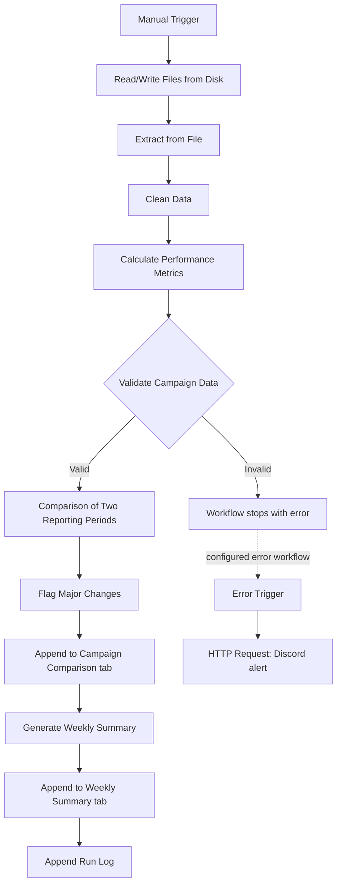

# Multi-Channel Campaign Reporting Assistant

An n8n automation that cleans marketing campaign data, validates it, calculates performance metrics, compares two reporting periods, flags significant changes, and records the results in Google Sheets. It includes input validation, execution logging, and Discord failure notifications.

**Project:** Week 4 Capstone: Internship Readiness
**Organization:** Advertidea
**Tools:** n8n, JavaScript, Google Sheets, Discord, CSV

---

## Table of Contents

1. [Project Overview](#1-project-overview)
2. [Features](#2-features)
3. [Technologies Used](#3-technologies-used)
4. [Workflow Architecture](#4-workflow-architecture)
5. [Input Data](#5-input-data)
6. [Performance Metrics](#6-performance-metrics)
7. [Data Cleaning and Validation](#7-data-cleaning-and-validation)
8. [Campaign Comparison and Change Detection](#8-campaign-comparison-and-change-detection)
9. [Sample Output](#9-sample-output)
10. [Google Sheets Outputs](#10-google-sheets-outputs)
11. [Setup Instructions](#11-setup-instructions)
12. [Test Cases](#12-test-cases)
13. [Limitations](#13-limitations)
14. [Future Improvements](#14-future-improvements)
15. [Demo Video](#15-demo-video)
16. [Repository Structure](#16-repository-structure)
17. [Conclusion](#17-conclusion)

---

## 1. Project Overview

Marketing teams often need to clean campaign data, calculate performance metrics, compare reporting periods, and identify campaigns that need attention. Doing this by hand is repetitive and time-consuming.

The Campaign Reporting Assistant automates this process in n8n. It reads campaign data from a CSV file, standardizes the input, validates required fields, calculates performance metrics, compares two reporting periods, flags significant changes, and writes the results to Google Sheets.

A separate error-notification workflow sends failure details to Discord when the main workflow fails during an automatic (non-manual) execution.

## 2. Features

- **CSV processing:** Reads campaign data from a local CSV file.
- **Data cleaning:** Standardizes campaign names, channel names, dates, currency codes, and numeric values, and drops fully empty rows.
- **Input validation:** Checks required fields, numeric values, negative metrics, and date formats. Any failure stops the workflow.
- **Performance calculations:** CTR, CPC, CPM, conversion rate, CPA, and ROAS.
- **Period comparison:** Compares each campaign across two reporting dates.
- **Change detection:** Flags metric changes of 20% or more for review.
- **Google Sheets integration:** Stores comparison results, a weekly summary, and run logs.
- **Execution logging:** Records run date, workflow name, status, number of validated records, and notes.
- **Discord notifications:** Sends an alert through a separate error workflow.

## 3. Technologies Used

| Technology | Purpose |
|---|---|
| n8n | Workflow automation and orchestration |
| JavaScript (n8n Code nodes) | Data cleaning, validation, calculations, and comparisons |
| CSV | Campaign data input |
| Google Sheets | Storing reporting results and run logs |
| Discord webhooks | Workflow failure notifications |

## 4. Workflow Architecture

### Main workflow: `campaign-reporting-assistant`

| # | Node | Type | Purpose |
|---|---|---|---|
| 1 | When clicking 'Execute workflow' | Manual Trigger | Starts the run |
| 2 | Read/Write Files from Disk | Read/Write Files | Reads the CSV from disk |
| 3 | Extract from File | Extract from File | Parses the CSV into rows |
| 4 | Clean Data | Code | Standardizes and normalizes fields |
| 5 | Calculate Performance Metrics | Code | Computes CTR, CPC, CPM, conversion rate, CPA, ROAS |
| 6 | Validate Campaign Data | Code | Throws an error if any row is invalid |
| 7 | Comparison of Two Reporting Periods | Code | Compares the previous and current dates per campaign |
| 8 | Flag Major Changes | Code | Flags changes of 20% or more |
| 9 | Append row in sheet1 | Google Sheets | Writes to the **Campaign Comparison** tab |
| 10 | Generate Weekly Summary | Code | Re-applies flagging and adds the spend review rule |
| 11 | Append row in sheet | Google Sheets | Writes to the **Weekly Summary** tab |
| 12 | Append Run Log | Google Sheets | Writes one row to the **Run Logs** tab |

### Error workflow: `error-notification-workflow`

An **Error Trigger** node followed by an **HTTP Request** node that posts the workflow name, failed node, error message, and execution URL to a Discord webhook. The main workflow is linked to it through its **Error Workflow** setting.

### Workflow Diagram



Validation failures stop the main workflow. The Discord alert is sent by the separate error workflow, so it depends on that workflow being active and correctly linked (see [Setup](#step-4-configure-discord-notifications)).

## 5. Input Data

The workflow expects a CSV file with these columns:

| Column | Description |
|---|---|
| `campaign_name` | Name of the marketing campaign |
| `date` | Reporting date (`YYYY-MM-DD`, or `M/D/YYYY`, which is converted) |
| `channel` | Advertising platform, such as Google Ads or Meta Ads |
| `currency` | Currency of spend and conversion value |
| `impressions` | Number of ad impressions |
| `clicks` | Number of ad clicks |
| `spend` | Advertising spend |
| `conversions` | Number of conversions |
| `conversion_value` | Total value attributed to conversions |

### Sample Input

```csv
campaign_name,date,channel,currency,impressions,clicks,spend,conversions,conversion_value
Google - Brand Search,2026-10-05,Google Ads,USD,10000,500,100,25,400
Meta - Summer Sale,2026-10-05,Meta Ads,USD,8000,240,120,12,360
Google - Brand Search,2026-10-12,Google Ads,USD,12000,660,132,33,594
Meta - Summer Sale,2026-10-12,Meta Ads,USD,9000,315,135,21,630
Google - Running Shoes,2026-10-05,Google Ads,USD,6000,180,90,9,270
Google - Running Shoes,2026-10-12,Google Ads,USD,7500,300,105,15,525
```

The sample contains six records across two reporting dates, covering three campaigns.

## 6. Performance Metrics

| Metric | Formula |
|---|---|
| CTR | `(Clicks / Impressions) × 100` |
| CPC | `Spend / Clicks` |
| CPM | `(Spend / Impressions) × 1,000` |
| Conversion Rate | `(Conversions / Clicks) × 100` |
| CPA | `Spend / Conversions` |
| ROAS | `Conversion Value / Spend` |

Metrics are rounded to two decimal places. When a denominator is zero or missing, the metric is set to `null` instead of dividing by zero.

## 7. Data Cleaning and Validation

### Cleaning (`Clean Data`)

- Removes rows where every value is empty (or `empty`, `null`, `undefined`).
- Trims whitespace and converts campaign names to Title Case.
- Normalizes `google ads` and `meta ads` to **Google Ads** and **Meta Ads** (case-insensitive). Other channel names are kept in lowercase.
- Converts `M/D/YYYY` dates to `YYYY-MM-DD`. Impossible dates are left unchanged and rejected later by validation.
- Uppercases currency codes.
- Converts numeric fields to numbers. Blank or non-numeric values become `null`.

### Validation (`Validate Campaign Data`)

The workflow throws an error, which stops the run and triggers the error workflow, when:

- No data is received.
- A required field is missing, blank, or `n/a`.
- A numeric field is missing, non-numeric, or negative.
- A date is not in `YYYY-MM-DD` format or is not a real calendar date (for example `2026-02-30`).

The error message lists every problem found, with row numbers.

## 8. Campaign Comparison and Change Detection

Campaigns are matched by **channel + campaign name** and compared between two reporting dates. For each of **spend, clicks, conversions, CPA, and ROAS**, the workflow records the previous value, the current value, the absolute change, and the percentage change.

A `comparison_status` column shows `Matched`, `Missing current period`, or `Missing previous period`.

### Flagging rules

A metric is flagged when its percentage change is **20% or more in either direction**. Each flag includes the direction and an interpretation:

| Metric | Interpretation |
|---|---|
| CPA | Decrease = *Improvement*, increase = *Potential Concern* |
| ROAS, Conversions | Increase = *Improvement*, decrease = *Potential Concern* |
| Spend, Clicks | *Review* (direction alone does not indicate good or bad) |

`needs_attention` is `true` when at least one flag is a *Potential Concern*. The **Generate Weekly Summary** step also sets `spend_review_required` and `needs_attention` to `true` when spend increases by 20% or more.

> **Current implementation note:** The reporting dates are hardcoded in the **Comparison of Two Reporting Periods** node as `2026-10-05` (previous) and `2026-10-12` (current). Update them to compare other periods.

## 9. Sample Output

Calculated from the sample input above (previous = 2026-10-05, current = 2026-10-12).

### Percentage change by campaign

| Campaign | Channel | Spend | Clicks | Conversions | CPA | ROAS |
|---|---|---|---|---|---|---|
| Google - Brand Search | Google Ads | +32.00% | +32.00% | +32.00% | 0.00% | +12.50% |
| Meta - Summer Sale | Meta Ads | +12.50% | +31.25% | +75.00% | −35.70% | +55.67% |
| Google - Running Shoes | Google Ads | +16.67% | +66.67% | +66.67% | −30.00% | +66.67% |

### Flags (|change| ≥ 20%)

| Campaign | Flagged metrics | Weekly Summary `needs_attention` |
|---|---|---|
| Google - Brand Search | Spend (Review), Clicks (Review), Conversions (Improvement) | `true`, because spend rose 32% |
| Meta - Summer Sale | Clicks (Review), Conversions (Improvement), CPA (Improvement), ROAS (Improvement) | `false` |
| Google - Running Shoes | Clicks (Review), Conversions (Improvement), CPA (Improvement), ROAS (Improvement) | `false` |

### Run log row

| run_date | workflow_name | status | campaigns_processed | notes |
|---|---|---|---|---|
| 2026-10-30 | Campaign Reporting Assistant | Success | 6 | Weekly summary generated |

`campaigns_processed` counts validated input **records** (six rows), not distinct campaigns (three).

## 10. Google Sheets Outputs

Create one spreadsheet with three tabs. Column headers must match the field names exactly because the comparison tabs use auto-mapping.

| Tab | Written by | Columns |
|---|---|---|
| **Campaign Comparison** | Append row in sheet1 | `campaign_name`, `channel`, `previous_date`, `current_date`, `comparison_status`, `{metric}_previous`, `{metric}_current`, `{metric}_change`, `{metric}_change_percent` for each of `spend`, `clicks`, `conversions`, `cpa`, `roas`, then `change_threshold_percent`, `flagged_change_count`, `change_flags`, `needs_attention` |
| **Weekly Summary** | Append row in sheet | Same as above, plus `spend_review_required` |
| **Run Logs** | Append Run Log | `run_date`, `workflow_name`, `status`, `campaigns_processed`, `notes` |

The **Append Run Log** node is set to *Execute Once*, so each run adds a single log row regardless of how many records were processed.

## 11. Setup Instructions

### Prerequisites

- A working n8n installation (n8n Cloud or self-hosted)
- A Google account with Google Sheets access
- A Discord server where you can create a webhook
- A CSV file that follows the input schema
- The two workflow JSON files from the `workflow/` folder

### Step 1: Import the workflows

1. Open your n8n instance.
2. Import `workflow/campaign-reporting-assistant.json`.
3. Import `workflow/error-notification-workflow.json`.
4. Review the nodes and connections.

### Step 2: Configure the CSV input

1. Save the CSV in a location the n8n process can read (for local n8n, the `.n8n-files` folder is a good choice).
2. Open the **Read/Write Files from Disk** node.
3. Replace the example path with the path to your CSV.
4. Run the node and confirm **Extract from File** returns the expected columns.

### Step 3: Configure Google Sheets

1. Create a Google spreadsheet with the three tabs described in [Section 10](#10-google-sheets-outputs).
2. Add the column headers to each tab.
3. Set up Google Sheets OAuth2 credentials in n8n.
4. In each of the three Google Sheets nodes, select your spreadsheet and the matching tab.

### Step 4: Configure Discord notifications

1. Create a Discord channel for alerts and add a webhook to it.
2. Open the **HTTP Request** node in the error-notification workflow and replace `YOUR_DISCORD_WEBHOOK_URL` with your webhook URL.
3. Activate the error-notification workflow.
4. In the main workflow, open **Settings** and set **Error Workflow** to `error-notification-workflow`.

> **Important:** n8n only runs an error workflow when a workflow fails in an **automatic (production) execution**. Failures during a manual **Execute workflow** run in the editor do not trigger it. To test end-to-end, temporarily add a Schedule or Webhook trigger to the main workflow, activate it, and run it against invalid data. You can also check the Discord message format on its own by executing the error workflow manually with its sample data.

> **Security:** Never commit a real Discord webhook URL, token, API key, or password. Keep placeholders in published files and configure real values locally. Before publishing, also replace your local file path and Google spreadsheet ID in the exported JSON.

### Step 5: Configure reporting dates

Open **Comparison of Two Reporting Periods** and update `previousDate` and `currentDate` to match your data.

### Step 6: Run the workflow

1. Confirm the CSV path, Google Sheets credentials, and reporting dates.
2. Click **Execute workflow**.
3. Check the three output tabs and the run log.
4. Run it again with invalid data (for example `sample-data/invalid-campaigns.csv`) and confirm validation fails with row-level error messages.

In its current configuration the workflow is designed for manual execution.

## 12. Test Cases

Tests were run with sample data during development.

| Test case | Expected result | Result |
|---|---|---|
| Valid CSV with six records | Workflow completes and writes results to all tabs | Passed |
| Missing required value | Validation rejects the input | Passed |
| Invalid calendar date, such as `2026-02-30` | Validation rejects the input | Passed |
| Negative metric value | Validation rejects the input | Passed |
| Successful execution logging | One new row appended to Run Logs | Passed |
| Failure notification (error workflow) | Discord alert delivered | Passed |

Production use should add tests for unexpected formats, missing reporting periods, and larger datasets.

## 13. Limitations

- **Local file dependency:** The CSV is read from a local path that must be changed for each environment.
- **Fixed comparison dates:** Reporting periods are hardcoded in the code node.
- **CSV input only:** The workflow does not pull live data from advertising platforms.
- **Manual trigger:** There is no scheduling, and manual runs do not fire the error workflow (see Step 4).
- **Credential setup:** Google Sheets and Discord must be configured by each user.
- **Fixed threshold:** The 20% threshold is set in the code nodes (`Flag Major Changes` and `Generate Weekly Summary`).
- **Slightly different attention rules:** `Flag Major Changes` (Campaign Comparison tab) does not apply the spend-increase rule that `Generate Weekly Summary` (Weekly Summary tab) does, so `needs_attention` can differ between the two tabs.
- **Success-only run log:** Run Logs records successful runs. Failures are reported through Discord only.
- **Matching assumptions:** Comparisons depend on campaign names, channels, and dates matching exactly after cleaning.
- **No currency conversion:** Values are assumed to be in comparable currencies.
- **Human review required:** A flagged change is a prompt for review, not proof that a campaign is performing well or badly.

## 14. Future Improvements

- Make reporting periods configurable (or detect the two most recent dates automatically).
- Connect directly to the Google Ads and Meta Ads APIs.
- Add scheduling and recurring reports.
- Log failures, with error details, to Google Sheets.
- Add retry logic and stronger error recovery.
- Make the change threshold configurable.
- Unify the flagging logic into a single step.
- Add currency conversion and deeper campaign analysis.
- Generate summaries with charts and recommendations.
- Add automated tests and support for larger datasets.

## 15. Demo Video

A five-to-eight-minute walkthrough covering:

1. Project overview and problem statement
2. Main workflow architecture
3. Sample CSV input and data cleaning
4. Metric calculations and period comparison
5. Google Sheets outputs
6. Input validation and a controlled failure test
7. Discord notification and run logging

**Demo link:** https://drive.google.com/file/d/1PTac6mfldl8ztIsIsz3PxfZ408viMjZM/view?usp=sharing

## 16. Repository Structure

```text
campaign-reporting-assistant/
│
├── README.md
│
├── workflow/
│   ├── campaign-reporting-assistant.json
│   └── error-notification-workflow.json
│
└── sample-data/
    └── sample-input.csv


```

## 17. Conclusion

The Multi-Channel Campaign Reporting Assistant shows how n8n and JavaScript can automate repetitive marketing reporting: validating incoming data, calculating performance metrics, comparing campaigns, storing results, and alerting users when a workflow fails.

It was built as a Week 4 capstone to demonstrate practical workflow automation, error handling, testing, documentation, and project delivery.
